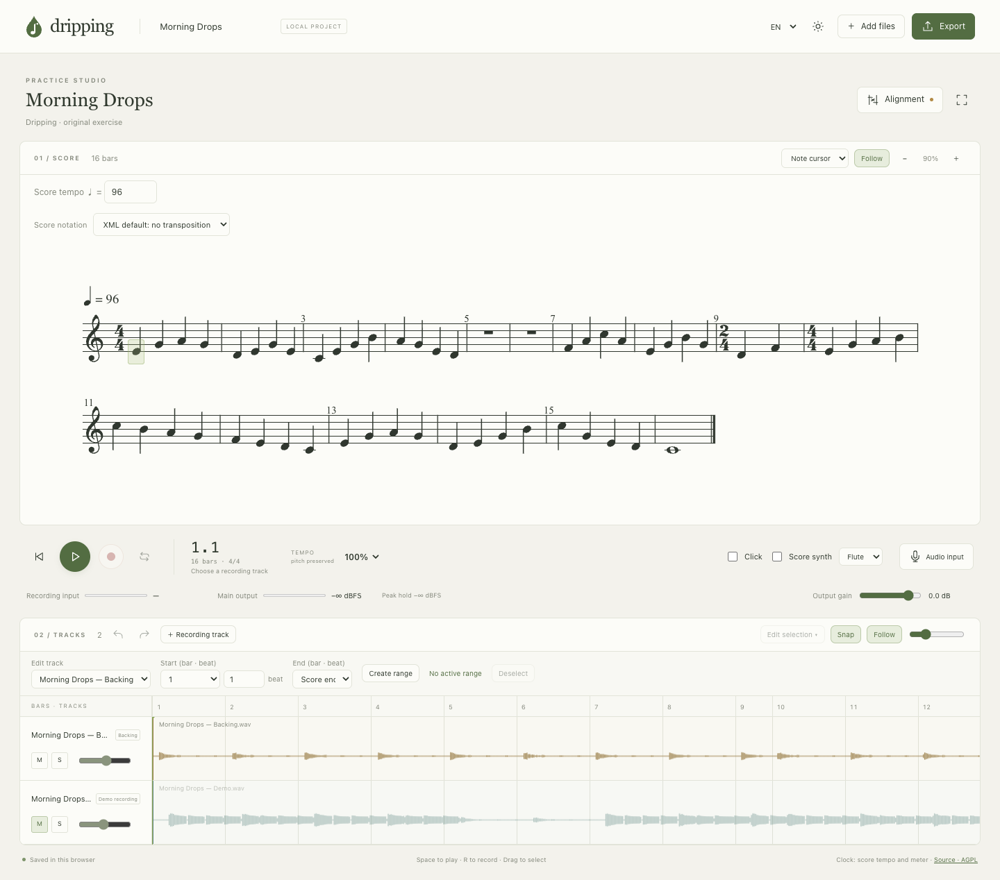

# Dripping

A browser workspace for practicing and recording music with sheet music and backing tracks. Import a score, loop a passage, slow down playback, and record your instrument on a separate track. Export WAV stems or a mix for further editing.

[Open Dripping](https://soapisnotfat.github.io/dripping/) · [User guide](docs/user-guide.md) · [Development](docs/development.md) · [Report a bug](https://github.com/soapisnotfat/dripping/issues)



*The included [Morning Drops exercise](src/lib/demo.ts), with generated backing and demonstration audio.*

## Try it

Open the app and choose **Try an example**. The included *Morning Drops* exercise has a score and generated backing and demonstration tracks, so no files or account are needed.

For your own session:

1. Choose **New practice** and import a PDF or MusicXML score (`.musicxml`, `.xml`, or `.mxl`), with optional backing and demonstration audio.
2. Confirm the score tempo, then review audio alignment against the score.
3. Select a passage to practice, add a recording track, and choose your audio input.
4. Export your takes, a mix, or a portable project backup.

The [user guide](docs/user-guide.md) covers alignment review, recording setup, clip editing, saving, and export formats. Recording requires microphone permission and HTTPS or localhost.

## What it does

- Renders interactive sheet music, with note selection and playback tracking.
- Recognizes PDFs in the browser while keeping the original PDF available.
- Loops selected passages and changes practice speed from 50% to 150% while preserving pitch.
- Aligns reference audio to the score, with listening review and editable source points.
- Records mono or stereo input separately from playback, with count-in and input metering.
- Edits audio regions without changing the source: trim, split, fades, volume, pan, and undo/redo.
- Exports WAV stems, a mix, original dry takes, and `.drippingproj` backups.

The interface supports English and Chinese, light and dark themes, and touch layouts. Desktop browser checks cover generated-input workflows; physical audio capture, latency calibration, and iPad/iPhone recording still need hardware testing. PDF recognition and automatic alignment require review. See the [validation record](docs/validation.md) for evidence and limits.

## Where your data lives

Scores, audio, recordings, and edits are stored in the current browser. No account or application backend is required. Each browser and site address has its own project library; export a **Project backup** to move or preserve a session independently of browser storage.

Dripping builds to a static site. PDF recognition code, runtime, and models are served as static files from the same site and run in browser workers. They load when PDF import needs them; ordinary practice does not precache the recognition package. The production app can work offline after its required resources are cached. See [PDF import](docs/pdf-import.md) and [deployment](docs/deployment.md).

## Run locally

Install **Node.js 22.12.0 or later** and npm:

```sh
git clone https://github.com/soapisnotfat/dripping.git
cd dripping
npm ci
npm run dev
```

Open the address printed in the terminal, usually `http://127.0.0.1:5173`. The first start prepares pinned PDF recognition resources and downloads missing files; it needs network access and may take longer than later starts.

```sh
npm run check  # TypeScript
npm test       # Unit and regression tests
npm run build  # Production site in dist/
```

For code navigation, formatting, browser checks, and build details, see [development](docs/development.md).

## Documentation

| If you want to… | Start here |
| --- | --- |
| Practice, record, save, or export | [User guide](docs/user-guide.md) |
| Understand the code and run checks | [Development and architecture](docs/development.md) |
| Host your own copy | [Static deployment](docs/deployment.md) |
| Inspect browser PDF recognition and its pinned resources | [PDF import](docs/pdf-import.md) |
| Understand the product boundaries | [Product scope](docs/product.md) |
| Check what has been verified | [Validation record](docs/validation.md) |
| Report a problem or propose a change | [Contributing](CONTRIBUTING.md) |

## License

The Dripping application is licensed under **AGPL-3.0-only**; see [LICENSE](LICENSE). Dependencies retain their own licenses and notices in [THIRD_PARTY.md](THIRD_PARTY.md). SheetScan source and resource provenance are recorded in [its pin](vendor/sheetscan/pin.json).

Imported scores, audio, recordings, and other user content retain their existing rights. The application software license does not relicense your files.
